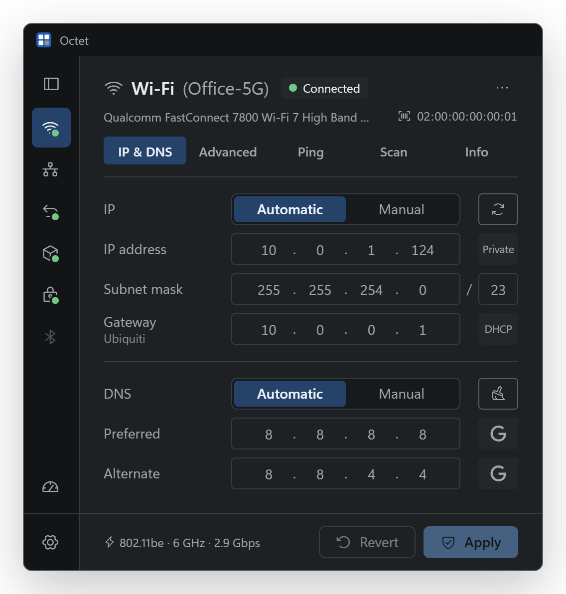
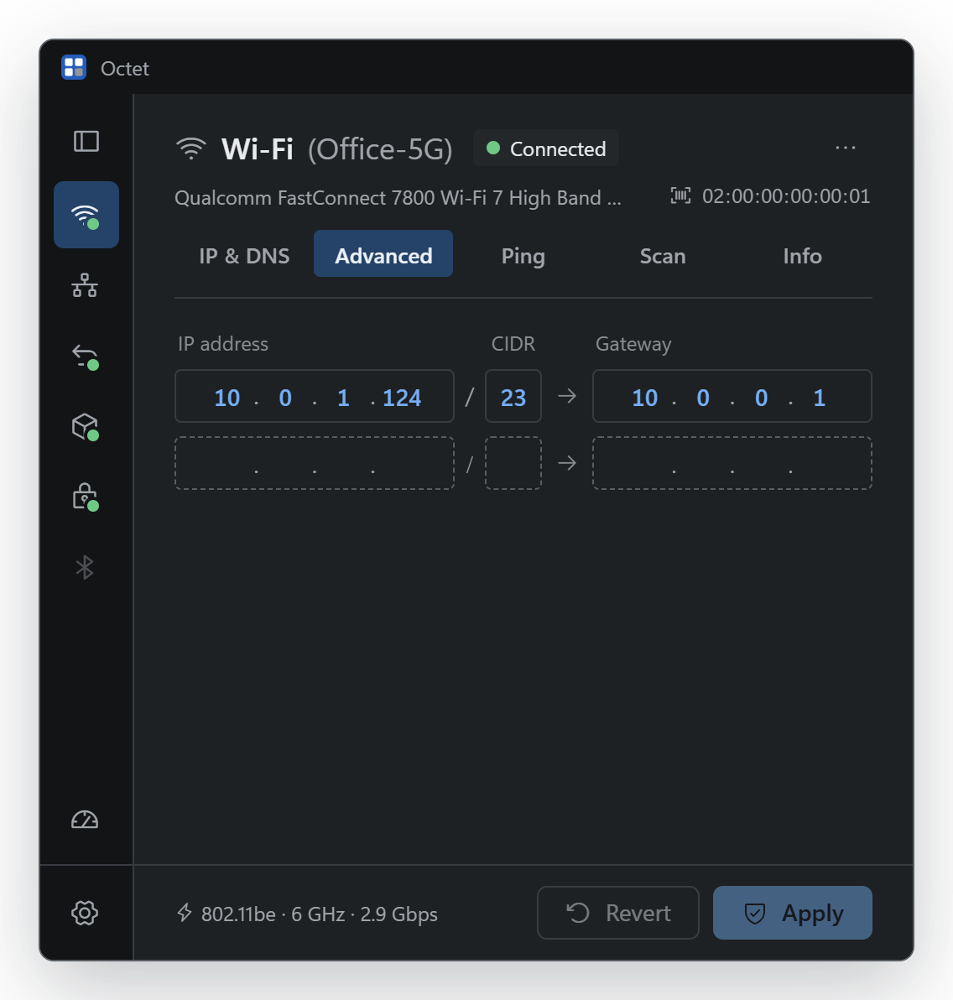
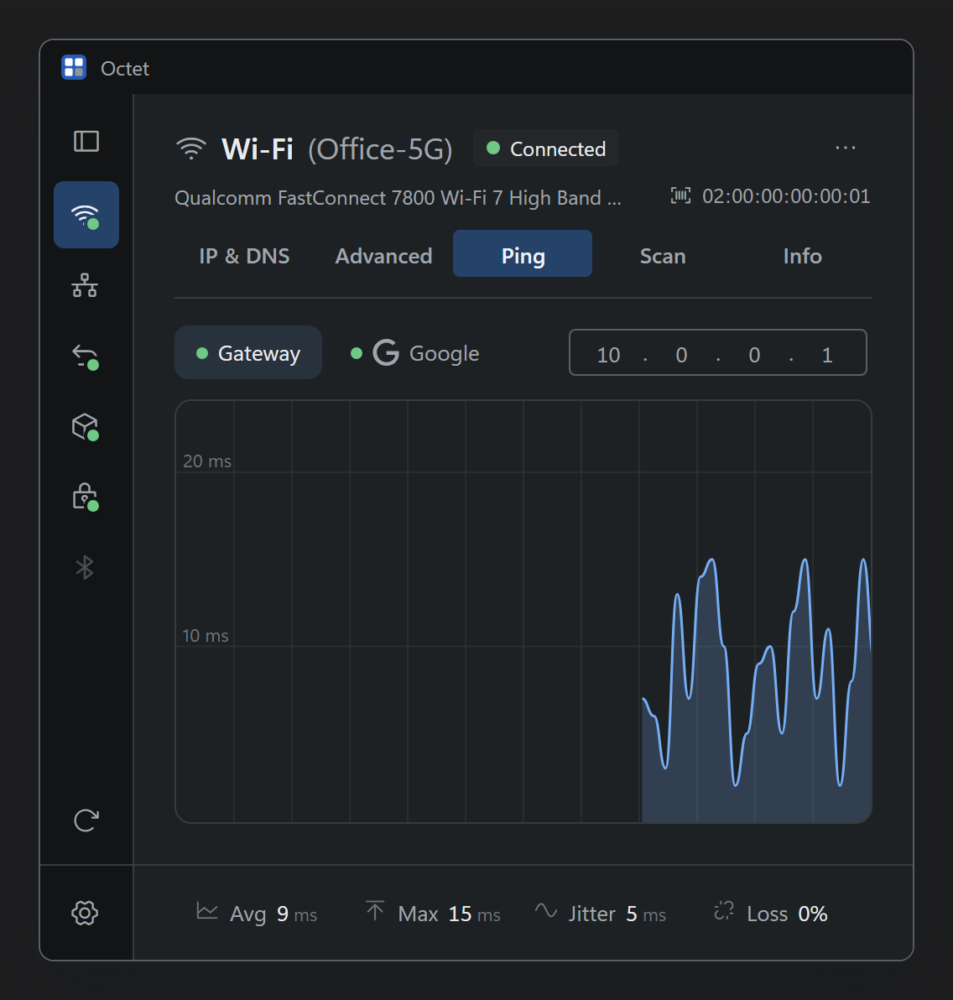
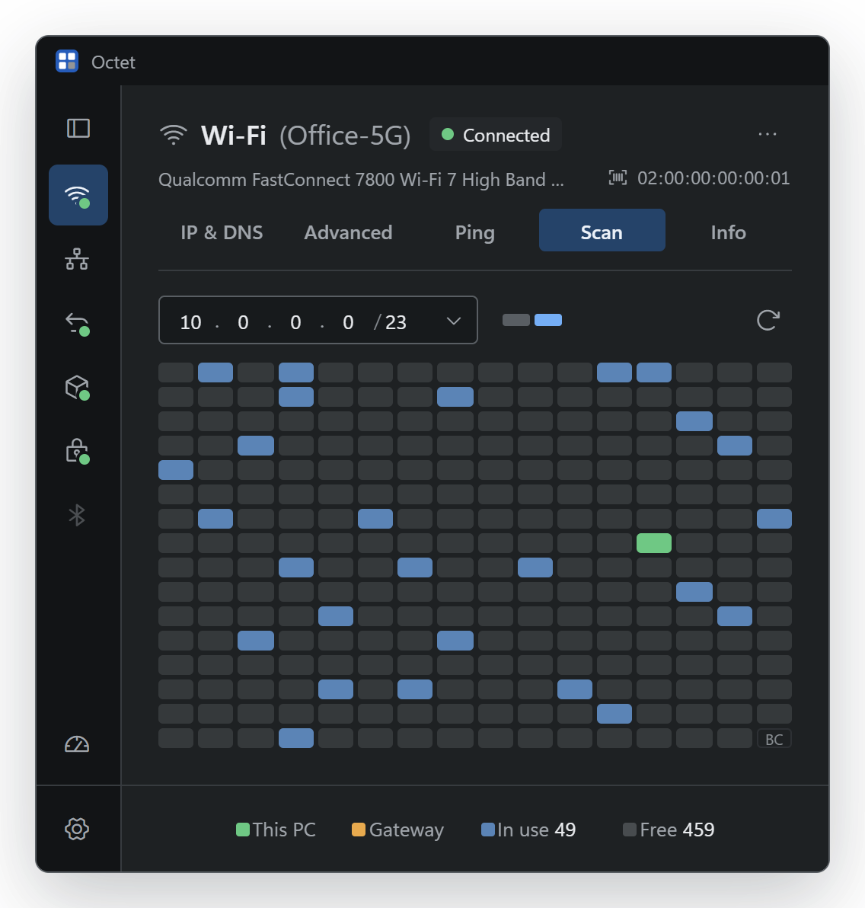
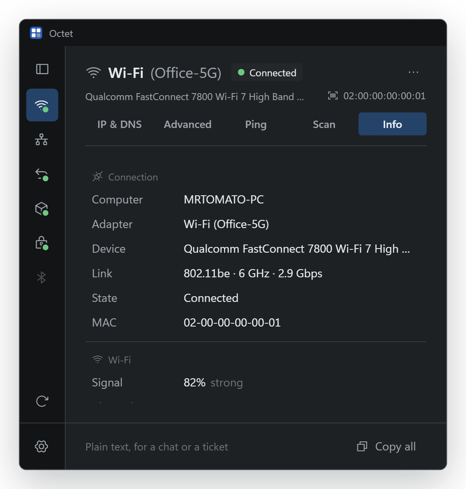

<div align="center">

# Octet

**Switch IPv4 and DNS on Windows in seconds. Then see who else is on the network.**

A fast, modern take on [Simple IP Config](https://github.com/KurtisLiggett/Simple-IP-Config), written in Rust.

[](https://github.com/MrTomato77/octet/releases/latest)
[](https://github.com/MrTomato77/octet/releases)

[](LICENSE)



**[Download Octet.exe](https://github.com/MrTomato77/octet/releases/latest)** &nbsp;·&nbsp; one portable file &nbsp;·&nbsp; no installer &nbsp;·&nbsp; no telemetry

</div>

---

## Five tabs, one adapter

**IP & DNS** &nbsp;DHCP or manual in one click. Every field is checked as you type, and before Apply Octet asks the network whether someone already has the address. After Apply it pings the gateway and DNS for you.

<table>
<tr>
<td width="50%" valign="top" align="center">
<br>
<b>Advanced</b><br>
<sub>Several addresses and gateways, with metrics</sub><br><br>
</td>
<td width="50%" valign="top" align="center">
<br>
<b>Ping</b><br>
<sub>Live latency, jitter and loss, out this adapter</sub><br><br>
</td>
</tr>
<tr>
<td width="50%" valign="top" align="center">
<br>
<b>Scan</b><br>
<sub>Who is on the subnet, with maker and MAC</sub><br><br>
</td>
<td width="50%" valign="top" align="center">
<br>
<b>Info</b><br>
<sub>Everything about the adapter, one click to copy</sub><br><br>
</td>
</tr>
</table>

### And the small things

- Follows Windows: cable, Wi-Fi and address changes show up on their own.
- Release / renew, flush DNS, enable / disable adapters, DNS presets.
- Copy or paste a whole setup as one line: `192.168.1.50/24 gw 192.168.1.1 dns 1.1.1.1, 8.8.8.8`
- Ctrl+1 to Ctrl+5 switch tabs. English and ไทย.

## Fast, all the way down

The backend is Rust talking to Windows directly: IP Helper for addresses, DNS and DHCP, ICMP for ping, WinHTTP for the one web request. No `ipconfig`, no PowerShell, no console windows flashing by. A DNS change takes milliseconds.

## Download

Get `Octet.exe` from [Releases](https://github.com/MrTomato77/octet/releases/latest) and run it.

- **Windows 11:** runs as is.
- **Windows 10:** needs the Microsoft Edge WebView2 Runtime. Most PCs already have it.
- **Not code-signed yet:** SmartScreen may say *"Windows protected your PC"* the first time. Choose *More info*, then *Run anyway*. Each release has `Octet.exe.sha256` to check the download:

  ```powershell
  (Get-FileHash .\Octet.exe).Hash
  ```

### macOS

Get `Octet.dmg` from the same release, open it and drag Octet onto Applications. It runs on Apple silicon and Intel, macOS 11 or later.

- **Not notarized yet:** the first time, macOS says it can't check Octet. Open *System Settings → Privacy & Security* and choose *Open Anyway*.
- **Wi-Fi name:** macOS gives the network's name only to apps with Location permission, so Octet asks once. Say no and everything else still works; only the name stays hidden.
- **What differs from Windows:** each change asks for your password (there is no *Run as admin*). There is no Advanced tab, because macOS keeps one address per network service. There is no Release, because macOS can only renew a lease. *Register in DNS* is Windows-only.

## Administrator permission

Octet opens without admin rights. It asks through UAC only when you Apply, enable / disable an adapter, or release / renew, and only that one change runs elevated (see [SECURITY.md](SECURITY.md)). Changing things often? Set *Settings → Run as admin* to *Always* and it asks once at start.

## Privacy

No telemetry, no server of its own. What it shows comes from Windows itself. On your network it sends only what you'd expect: an ARP check before Apply, pings to the gateway and DNS after it, pings and ARP while you Ping or Scan, and a reverse name lookup for the gateway. Device makers come from the IEEE list built into the app; MAC addresses are never looked up online. The internet is reached only when you ask: your public IP (Info) and the speed test, both through Cloudflare ([speed.cloudflare.com](https://speed.cloudflare.com)), out through the adapter on screen. Updates are looked for on GitHub only when you press the button in Settings, and a download is installed only if its signature checks out and it is newer than the copy you run.

## Build

```powershell
cargo build --release -p octet   # target/release/octet.exe
```

On a Mac, `crates/octet/macos/bundle.sh` builds `target/release/Octet.app` and `Octet.dmg` (`--native` for this Mac's architecture only, which is faster).

Releases are built by [GitHub Actions](.github/workflows/release.yml) on each `v*` tag. The interface is one file, `ui/index.html`; open it over http in a browser and it runs on sample data and changes nothing.

## License

[MIT](LICENSE). Bundled icons, logos and crates are listed in [THIRD-PARTY-NOTICES.md](THIRD-PARTY-NOTICES.md).
Inspired by Simple IP Config by Kurtis Liggett (GPL-3.0); Octet shares no code with it.
