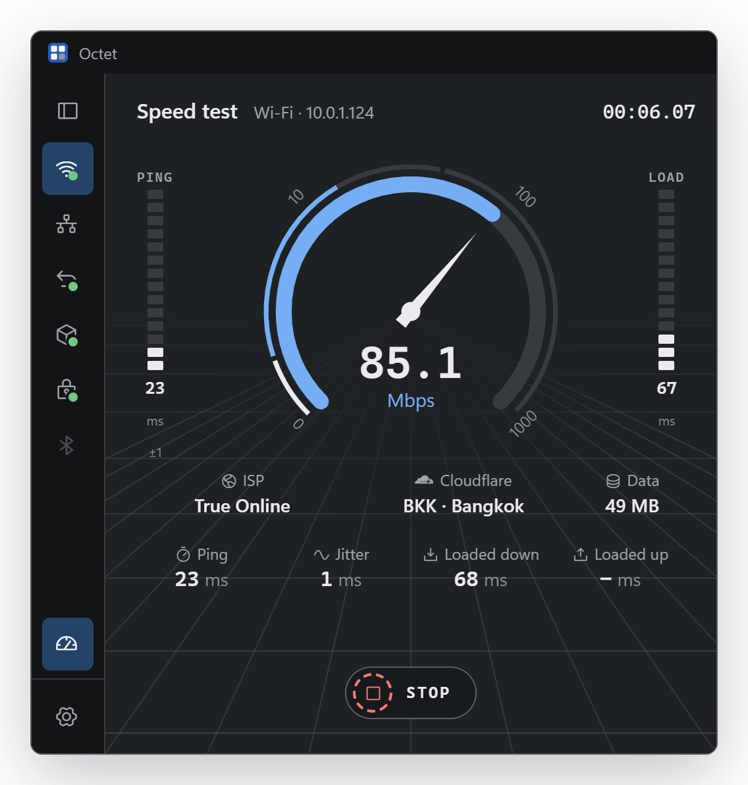

# Octet

**Switch IPv4 and DNS in seconds. Then see who else is on the network.**

A fast, modern take on [Simple IP Config](https://github.com/KurtisLiggett/Simple-IP-Config), written in Rust. For Windows and macOS.

**[Download](https://github.com/MrTomato77/octet/releases/latest)** &nbsp;·&nbsp; `Octet.exe` or `Octet.dmg` &nbsp;·&nbsp; no installer &nbsp;·&nbsp; no telemetry

---

**IP & DNS** &nbsp;DHCP or manual in one click. Every field is checked as you type, and before Apply Octet asks the network whether someone already has the address. After Apply it pings the gateway and DNS for you.

<table>
<tr>
<td width="50%" valign="top" align="center">
 
<b>Advanced</b> 
Several addresses and gateways, with metrics  
</td>
<td width="50%" valign="top" align="center">
 
<b>Ping</b> 
Live latency, jitter and loss, out this adapter  
</td>
</tr>
<tr>
<td width="50%" valign="top" align="center">
 
<b>Scan</b> 
Who is on the subnet, with maker and MAC  
</td>
<td width="50%" valign="top" align="center">
 
<b>Info</b> 
Everything about the adapter, one click to copy  
</td>
</tr>
<tr>
<td colspan="2" align="center">
 
<b>Speed test</b> 
Download, upload and latency under load, out this adapter  
</td>
</tr>
</table>

- Follows the system: cable, Wi-Fi and address changes show up on their own.
- Renew (and release, on Windows), flush DNS, enable / disable adapters, DNS presets, and a speed test.
- Copy or paste a whole setup as one line: `192.168.1.50/24 gw 192.168.1.1 dns 1.1.1.1, 8.8.8.8`
- Ctrl+1 to Ctrl+5 (⌘ on a Mac) switch tabs. English and ไทย.

## Good to know

- **First run:** Octet isn't code-signed or notarized yet. On Windows choose *More info → Run anyway*; on macOS, *System Settings → Privacy & Security → Open Anyway*.
- **Admin rights:** asked only for the change itself (Apply, enable / disable, release / renew), never just to open the app: UAC on Windows, your password on macOS.
- **Privacy:** no telemetry and no server of its own. The internet is reached only for your public IP and the speed test (through Cloudflare), and for updates when you ask.

Details on each of these, the macOS differences, and how to build: **[docs/guide.md](docs/guide.md)**.

## Star history

**Thank you** to everyone who uses Octet, reports a bug, suggests an idea or tries a new build. Every star tells us the app is worth making better.

<a href="https://www.star-history.com/#MrTomato77/octet&Date">
  <picture>
    <source media="(prefers-color-scheme: dark)" srcset="https://api.star-history.com/svg?repos=MrTomato77/octet&type=Date&theme=dark">
    
  </picture>
</a>

## License

[MIT](LICENSE). Bundled icons, logos and crates are listed in [THIRD-PARTY-NOTICES.md](THIRD-PARTY-NOTICES.md).
Inspired by Simple IP Config by Kurtis Liggett (GPL-3.0); Octet shares no code with it.
